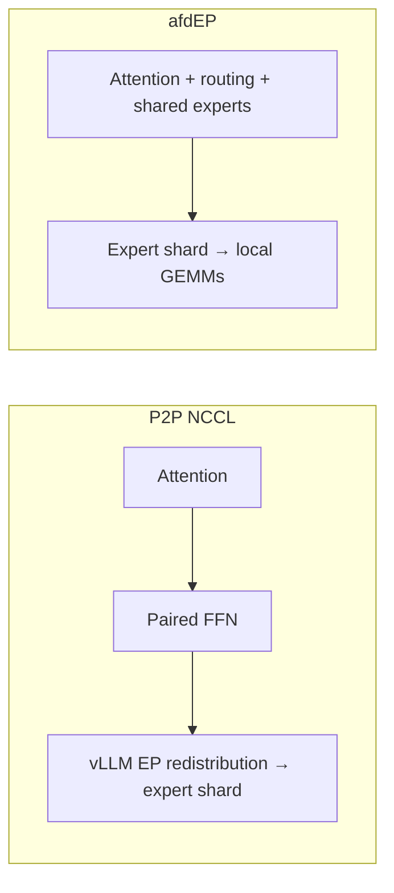

# afdEP connector — initial serving integration

Run prefill and decode in one deployment: four Attention GPUs and four FFN
GPUs, DP=4/TP=1 per role, 16 of DeepSeek-V2-Lite's 64 routed experts per FFN
rank. The current backend requires two separate four-GPU NVLink domains and
NCCL GIN connectivity. “Single hop” means no second vLLM expert redistribution;
hybrid transport still uses local NVLink forwarding.

Install afdEP's fixed-capacity graph branch (`codex/vllm-bootstrap-ranks`) and
compatible DeepGEMM with its BF16 psum grouped API. Set matching NCCL headers and
runtime through `AFDEP_NCCL_ROOT`/`LD_LIBRARY_PATH`, and configure NIC affinity.
The optional `AFDEP_DEEPGEMM_MODULE`/`AFDEP_DEEPGEMM_ROOT` variables accept an
explicitly staged DeepGEMM extension and matching JIT sources.

On each role's four-GPU host, set `MODEL_PATH`, `ROLE`, and `AFD_HOST` (FFN host),
then run `bash recipe/gpu/AfdEPConnector/deepseek_v2_lite.sh`.
Use `CONNECTOR=P2pNcclAFDConnector` for the baseline; use `EAGER=1` to disable
graphs for either connector.

| Path | Attention prefill | FFN prefill | Decode |
| --- | --- | --- | --- |
| P2P NCCL | Eager | Eager | Graph sizes 1/8/32 |
| afdEP | Eager | One capacity graph, GPU counts | Same FFN graph |

The FFN graph covers all routed layers: receive → local grouped GEMMs → reply.
It is independent of Attention's decode graphs. Capture and JIT warmup are
excluded from steady-state timing; every timed replay remains included.

Validation is in progress. No serving speedup is established yet. Compare mixed
prefill sizes and decode under sustained concurrency, preserve outputs and raw
latencies, and profile separately. This also changes the GEMM implementation
and moves shared/dense work to Attention; an end-to-end gain cannot be attributed
solely to removing EP redistribution.
