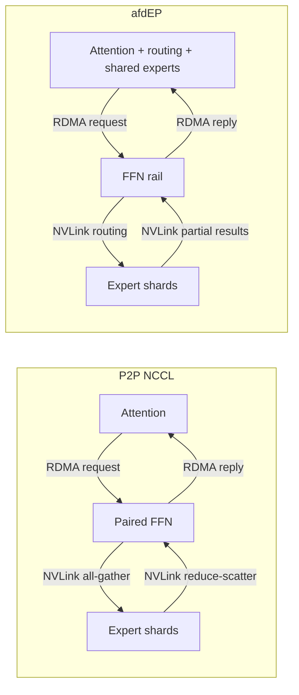
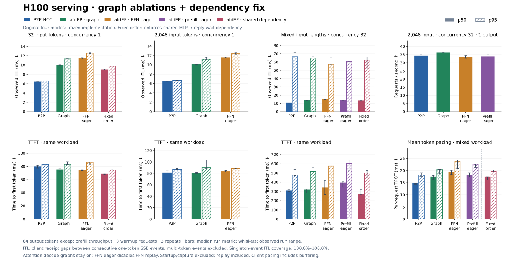

# afdEP connector — initial serving integration

Run prefill and decode in one deployment: four Attention GPUs and four FFN
GPUs, DP=4/TP=1 per role, 16 of DeepSeek-V2-Lite's 64 routed experts per FFN
rank. The current backend requires two separate four-GPU NVLink domains and
NCCL GIN connectivity. Both paths use local NVLink movement. afdEP performs it
inside its transport; P2P uses vLLM's separate EP collectives.

Install the pinned `afdep` extra from this checkout and
compatible DeepGEMM with its BF16 psum grouped API. Set matching NCCL headers and
runtime through `AFDEP_NCCL_ROOT`/`LD_LIBRARY_PATH`, and configure NIC affinity.
The optional `AFDEP_DEEPGEMM_MODULE`/`AFDEP_DEEPGEMM_ROOT` variables accept an
explicitly staged DeepGEMM extension and matching JIT sources.

On each role's four-GPU host, set `MODEL_PATH`, `ROLE`, and `AFD_HOST` (FFN host),
then run `bash recipe/gpu/AfdEPConnector/deepseek_v2_lite.sh`.
Use `CONNECTOR=P2pNcclAFDConnector` for the baseline; use `EAGER=1` to disable
graphs for either connector. `FFN_GRAPH=0` disables steady-state afdEP FFN replay
while keeping Attention decode graphs and paired startup captures.
`PREFILL_GRAPH=0` disables only FFN prefill replay; decode still uses its graph.
Use `HYBRID=0` on both roles to test direct transfers to expert owners instead
of RDMA plus local NVLink forwarding. This does not change graph policy.

| Path | Attention prefill | FFN prefill | Decode |
| --- | --- | --- | --- |
| P2P NCCL | Eager | Eager | Graph sizes 1/8/32 |
| afdEP | Eager | One capacity graph, GPU counts | Same FFN graph |

The FFN graph covers all routed layers: receive → local grouped GEMMs → reply.
It is independent of Attention's decode graphs. Capture and JIT warmup are
excluded from steady-state timing; every timed replay remains included.

## H100 serving experiment

[Measurements and provenance](itl-h100.json): 48 runs on eight H100s, BF16,
DeepSeek-V2-Lite, matched GPUDirect/NIC settings. Short-request median ITL is
6.40 ms for P2P, 9.97 ms for afdEP, and 11.42 ms with FFN replay disabled.
Correcting the compiled shared-expert dependency reduces afdEP to 9.03 ms;
Nsight verifies shared computation precedes the reply wait on all Attention GPUs.
The original graph mode reaches 36.11 versus 34.14 requests/s for the
2,048-token, concurrency-32, one-output prefill case. No overall serving win.

The dependency correction is a separate experiment from the frozen graph
controls. The implementations also differ in GEMM backend and shared/dense
compute placement. Generated token sequences sometimes differ, including across
the dependency correction; these results establish neither accuracy equivalence
nor a transport-only speedup. Client ITL includes scheduling and buffering.
