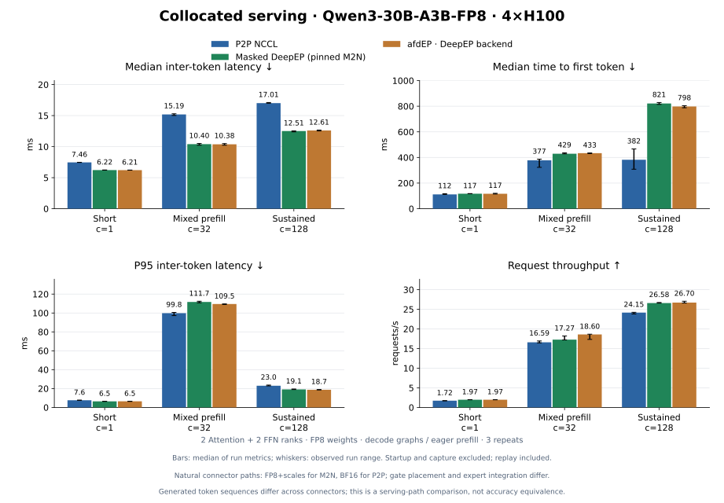
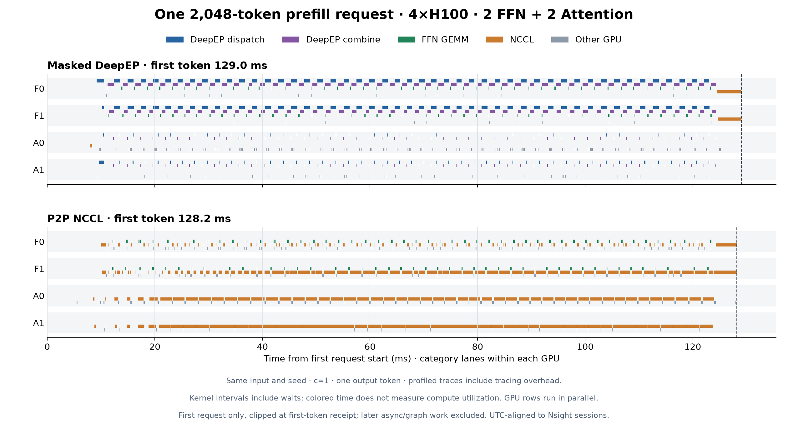

# afdEP · DeepEP transport backend



`AfdEPConnector` keeps the DeepEP M2N scheduler, Attention-side routing and
DeepGEMM runner, and loads communication through the standalone
[afdEP library](https://github.com/ms-llmd/afdEP).
By default it runs afdEP v2.1's AFD role path (directional counts and exits,
role-sized buffers and kernels); `role_aware: false` keeps Masked DeepEP's
union-rank protocol and dummy expert slots on the same build.
The H100 experiment below predates the role path: it measured the Masked
protocol (ms-llmd/afdEP#6).

## H200: role path vs Masked on the same build

Same recipe, workloads and seeds as the H100 experiment, on 4 x H200 (one
NVLink domain, 2 Attention + 2 FFN, no DBO). Arms differ only in
`ROLE_AWARE` (afdEP `c6dc53f`, native digest `958652a3`; plugin `e5b027f`).
Two sessions per arm, interleaved, 3 repeats each; paired change of the
role path against Masked, with the number of pairs where the role path is
higher:

| Workload | ITL median | TPOT median | TTFT median | Throughput |
| --- | --- | --- | --- | --- |
| Short | 5.28 vs 5.72 ms, -7.6% (0/6) | -7.5% (0/6) | -1.8% (0/6) | +7.0% (6/6) |
| Mixed | 8.49 vs 8.94 ms, -4.6% (0/6) | -1.9% (2/6) | +2.6% (3/6) | +2.1% (6/6) |
| Sustained | 10.37 vs 10.82 ms, -4.1% (0/6) | -3.8% (0/6) | +33% (4/6) | -1.7% (3/6) |

Short outputs are identical (192/192); the other workloads differ only after
the first token, as concurrent batches do. Sustained TTFT is bimodal in both
arms (the second request wave); in controlled prefill bursts (128 concurrent
256-token prompts from an idle server, 12 bursts per arm) the role path's
median TTFT is 461 ms against 547 ms. [Per-run results](serving-h200.json).

## H100 experiment

| Setting | Measured configuration |
| --- | --- |
| Topology | One NVLink domain, four H100 80 GB; 2 Attention + 2 FFN |
| Model | Qwen3-30B-A3B-FP8, [pinned revision](https://huggingface.co/Qwen/Qwen3-30B-A3B-FP8/tree/d206ba732169f29bb77fbf80fc2c4b81d4d30782); 64 real experts per FFN |
| Runtime | vLLM 0.30.0, PyTorch 2.13.0+cu130, NCCL 2.30.7 |
| Parallelism | DP2 / TP1 per role, FFN EP2, no DBO |
| Graph policy | Eager prefill; decode graphs at 1 / 8 / 32 / 128 tokens |
| Scheduling | Max 128 sequences, 2,048 batched tokens, model length 4,096 |
| Measurement | 3 repeats per path/workload, 8 warmup requests per repeat |

[Results and source hashes](serving-h100.json) cover 27 runs, 3,744 requests
and 678,240 observed token intervals, with no coalesced events. afdEP closely
matches Masked DeepEP: median ITL is 6.21 / 10.38 / 12.61 ms across the three
workloads. Both improve median ITL and throughput over P2P here, while TTFT
is worse, particularly under sustained load. Mixed-workload P95 ITL is also worse.

This compares natural serving paths: DeepEP/afdEP send FP8 plus scales and
route on Attention; P2P sends BF16 and routes on FFN. Expert integration differs.
Concurrent generated sequences are not all identical, including between
DeepEP and afdEP. This is a performance experiment, not an accuracy-equivalence
or transport-only claim. Startup, compilation and capture are excluded;
every timed graph replay is included. Whiskers show run ranges, not confidence intervals.



[Profiling data and trace hashes](profiling-h100.json): isolated 2,048-token
prefill takes about 129 ms on each path under tracing. Waiting moves between
Attention and FFN; colored intervals include communication polling. The larger
TTFT difference under load needs separate serving/queueing analysis. These traces
do not measure an afdEP specialization or isolated network-transfer time.

## Run

Install this checkout with `uv sync --group dev --extra vllm --extra afdep`.
Provide matching NCCL headers/runtime with device API support through
`AFDEP_NCCL_ROOT` and `LD_LIBRARY_PATH`, plus CUDA compilation tools.
Set `MODEL_PATH` to the local model snapshot. In two terminals on the same
four-GPU host, start FFN first, then Attention:

```bash
ROLE=ffn bash recipe/gpu/AfdEPConnector/qwen3_30b_fp8/serve.sh
ROLE=attention bash recipe/gpu/AfdEPConnector/qwen3_30b_fp8/serve.sh
```

Set `CONNECTOR=DeepEPM2NAFDConnector` or `CONNECTOR=P2pNcclAFDConnector` on
both roles for each baseline, or `ROLE_AWARE=0` for afdEP's Masked protocol.
Stop both servers before changing connector.
The single-node network preset selects local transport; these runs do not
exercise NCCL GIN across nodes. `cpu_sync_min_tokens=0` enables exact receive
counts via CPU synchronization during eager prefill; captured decode uses GPU counts.

After both servers are ready, run the client for each row with
`--warmup 8 --model qwen3-30b-afdep --url http://127.0.0.1:18305`:

| Workload | `--input-tokens` | `--output-tokens` | `--concurrency` | `--requests` |
| --- | --- | --- | --- | --- |
| Short | `32` | `64` | `1` | `32` |
| Mixed | `32 128 512 1024 1536 2048` | `64` | `32` | `128` |
| Sustained | `256` | `256` | `128` | `256` |

Use `python tools/benchmarks/bench_afdep.py ... --output result.json`.
For repeats 0–2, set `--seed` to `9242 + 1000 × output_tokens + 100 × concurrency + repeat`.
The client records token IDs and receipt timestamps; it reports unresolved
coalesced intervals rather than inventing individual token timings.
