# AFD connector regression suite

Compare **P2P → Masked DeepEP → afdEP v1 → afdEP v2** on the same GPUs and requests.
The primary regression control is Masked DeepEP; the P2P comparison measures
complete serving paths, including its FFN expert-parallel exchange.

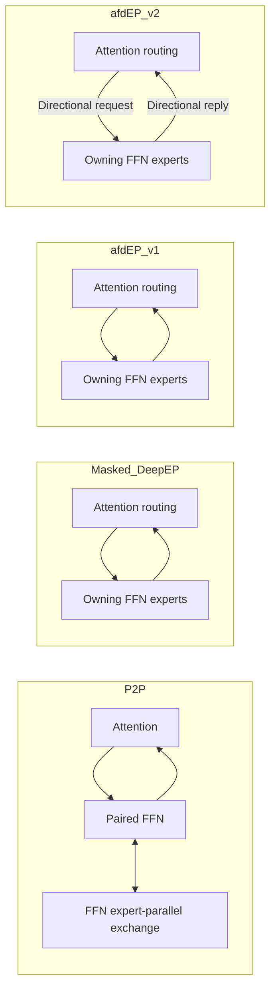

Masked DeepEP and v1 share scheduling, payload precision, expert compute and
transport. V1 enables explicit roles, removes unused Attention payload arenas
and empty-side epilogues, and bounds FFN receives by Attention source count.
Logical expert slots, collective participation and registered transport capacity
remain. P2P naturally uses BF16 payloads and FFN routing; the routed paths use
FP8 plus scales and Attention routing. Their difference is not transport alone.

## Four-way results · 2026-10-19

Eight balanced repeats, **128 cells and 29,696 measured requests per GPU setup**.
Paired geometric-mean output-throughput gains for v2 against Masked DeepEP:

| Workload | H100 | H200 |
| --- | ---: | ---: |
| Decode · C1 | +2.9% | +1.3% |
| Prefill · C8 | +12.4% | +10.5% |
| Mixed · C32 | +11.1% | +7.9% |
| Sustained · C128 | +5.7% | +6.8% |

All eight throughput intervals favor v2. **H200 meets the preset gate; H100 is
inconclusive** because sustained median TTFT's interval extends to +4.0%, beyond
the 3% budget. P2P has better sustained P95 TTFT despite lower throughput.
H200 decode median/P95 TPOT are slightly slower, within budget. Both v1 and v2
match Masked on all **256/256** tested C1 sequences per setup.

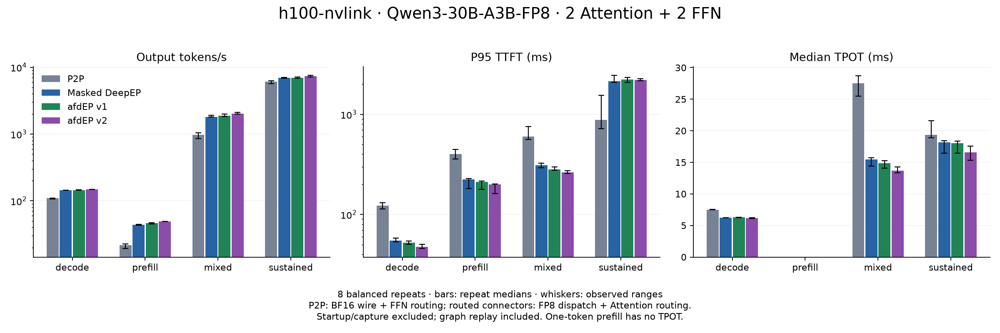

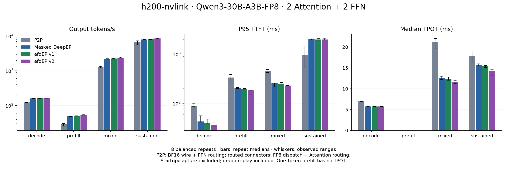

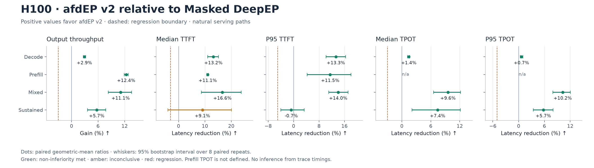

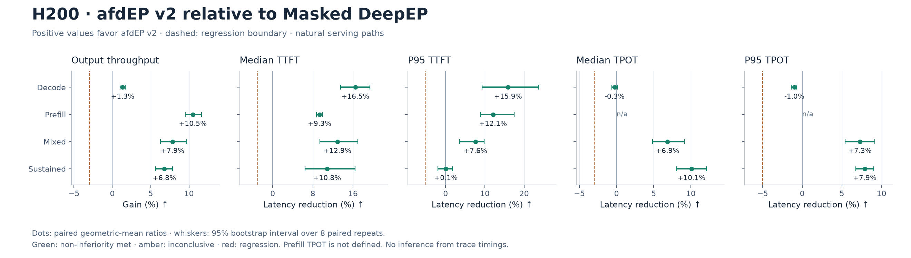

| Evidence | H100 | H200 |
| --- | --- | --- |
| Measurements + hashes | [Manifest](baselines/h100-nvlink-v2-20261019/manifest.json) | [Manifest](baselines/h200-nvlink-v2-20261019/manifest.json) |
| All controls + confidence intervals | [Comparison](baselines/h100-nvlink-v2-20261019/comparison.json) | [Comparison](baselines/h200-nvlink-v2-20261019/comparison.json) |
| Frozen runtime + backup provenance | [Provenance](baselines/h100-nvlink-v2-20261019/provenance.json) | [Provenance](baselines/h200-nvlink-v2-20261019/provenance.json) |
| Scoped decode token parity | [256 sequences](baselines/h100-nvlink-v2-20261019/decode-parity.json) | [256 sequences](baselines/h200-nvlink-v2-20261019/decode-parity.json) |
| Fresh exchange + memory sweeps | [18 configurations](baselines/h100-nvlink-v2-20261019/exchange-index.json) | [18 configurations](baselines/h200-nvlink-v2-20261019/exchange-index.json) |
| Nsight kernel/host metrics + coverage | [Profile](baselines/h100-nvlink-v2-20261019/profiling.json) | [Profile](baselines/h200-nvlink-v2-20261019/profiling.json) |

All four use decode graphs and eager prefill. Startup/capture/warmup are excluded;
runtime replay is included. These finite synthetic loads include ramp-up/drain.
P2P uses BF16/FFN routing; routed connectors use FP8/Attention routing. Full raw
streams and logs are retained outside Git with verified archive/file hashes.

<details>
<summary>Communication allocations and serving traces</summary>

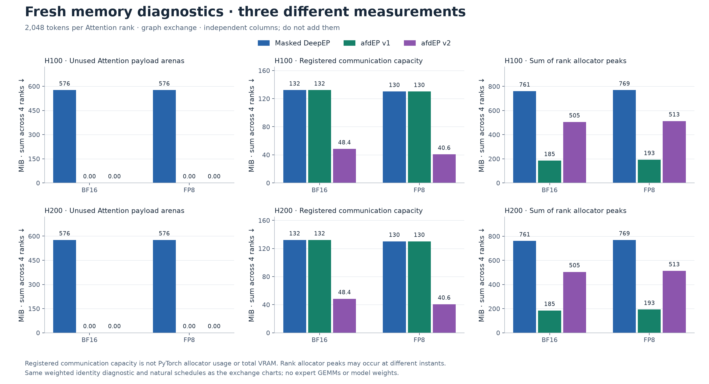

V2 registered capacity is **63–69% smaller than Masked** here. Its PyTorch
allocator peak is higher than v1's; these columns measure different quantities
and are not total serving VRAM.

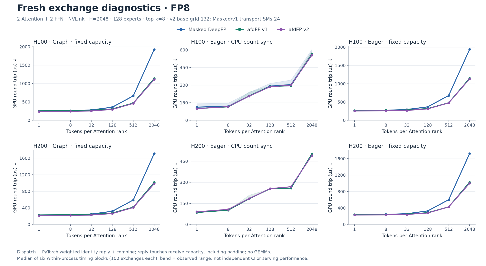

The 36 fresh jobs cover BF16/FP8 × graph/count-synchronized eager/capacity eager
for all three routed connectors. Six blocks per process show observed ranges,
not independent confidence intervals. Weighted identity touches receive capacity;
these timings exclude expert GEMMs and are not pure network bandwidth.

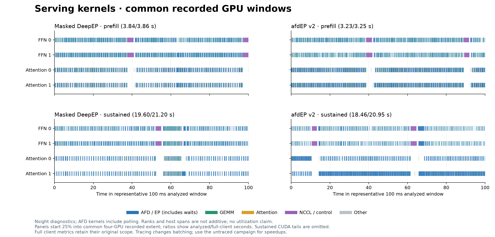

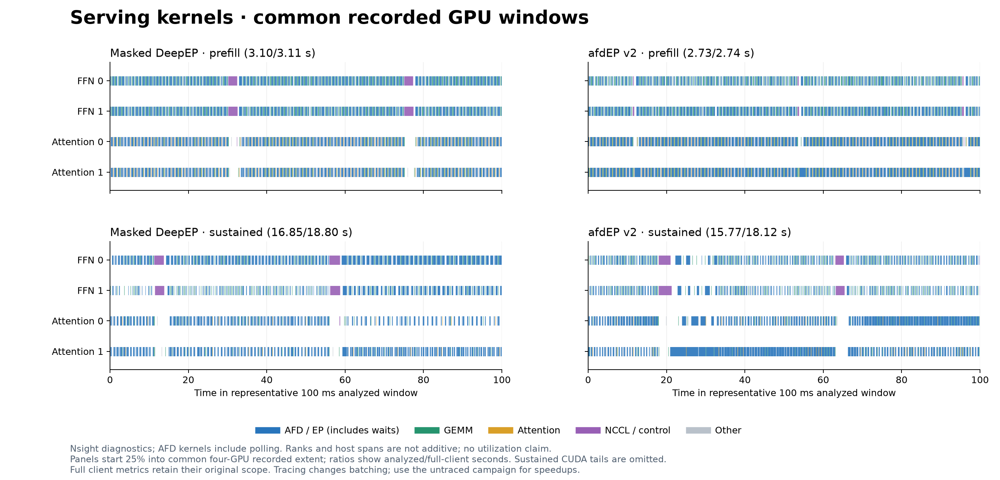

FFN CUDA records end early in sustained captures. Analysis uses the common
four-GPU recorded extent: **88–92% H100 / 87–90% H200** of those client windows.
Omitted tails are explicit. Long reply/receive kernels include waits for expert
compute and peer progress; shared blocking metadata calls remain. Their spans
are not removable CPU costs, additive phases or utilization measurements.
Sustained serving mixes decode graphs with new eager prefill work.

</details>

<details>
<summary>Earlier three-way baselines and v1 diagnosis</summary>

## Initial baselines · 2026-10-19

Six balanced repeats per SKU, **16,704 measured requests each**. Percentages
below are paired geometric-mean throughput changes against Masked DeepEP.

| Workload | H100 | H200 |
| --- | ---: | ---: |
| Decode | -0.1% | +0.7% |
| Prefill | +5.5% | +2.8% |
| Mixed | +3.0% | +2.1% |
| Sustained | -0.7% (inconclusive) | +2.1% |

**Overall gate: inconclusive on both SKUs.** H100 sustained throughput, median
TPOT and TTFT intervals cross their budgets; H200 sustained TTFT intervals do
as well. No primary metric establishes a regression. This is not evidence that
all latency metrics are unchanged. Both routed paths also have worse sustained
P95 TTFT than P2P despite higher throughput.

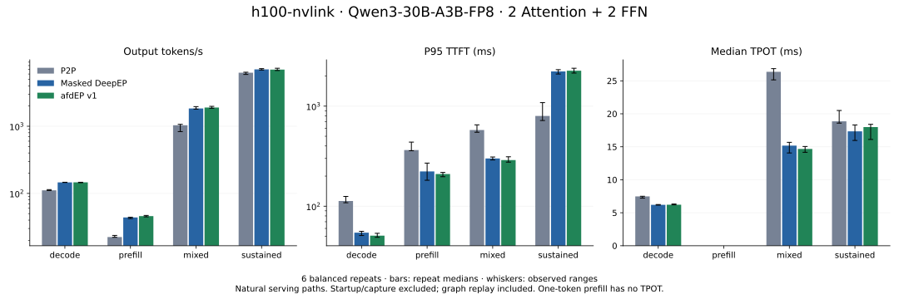

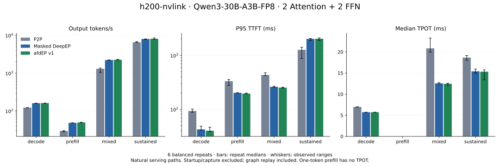

| Evidence | H100 | H200 |
| --- | --- | --- |
| Measurements + request hashes | [Manifest](baselines/h100-nvlink-20261019/manifest.json) | [Manifest](baselines/h200-nvlink-20261019/manifest.json) |
| Ratios + 95% intervals + gates | [Comparison](baselines/h100-nvlink-20261019/comparison.json) | [Comparison](baselines/h200-nvlink-20261019/comparison.json) |
| Runtime + archive provenance | [Provenance](baselines/h100-nvlink-20261019/provenance.json) | [Provenance](baselines/h200-nvlink-20261019/provenance.json) |
| Exchange diagnostics | [12 passing jobs](baselines/h100-nvlink-20261019/exchange-index.json) | [12 passing jobs](baselines/h200-nvlink-20261019/exchange-index.json) |
| Single-request decode parity | [192/192 sequences](baselines/h100-nvlink-20261019/decode-parity.json) | [192/192 sequences](baselines/h200-nvlink-20261019/decode-parity.json) |

Parity covers seeded synthetic decode at concurrency 1, not general model
accuracy or concurrent-output equivalence. Full request events and role logs
are retained outside Git; the manifests contain their request-artifact hashes.
The initial manifest's `nccl_runtime` tuple is PyTorch's **build** version;
provenance separately verifies the loaded NCCL library as 2.30.7.

In the 2,048-token FP8 graph diagnostic, v1 removes **576 MiB** of unused
Attention payload arenas across two ranks. Registered transport capacity remains
**130 MiB** across four ranks. PyTorch allocation and registered capacity are
separate measurements; the serving GPU-memory snapshots are neither of these.

### Focused H100 profile

[Paired Nsight evidence](baselines/h100-nvlink-20261019/profiling.json) verifies
all four GPUs and graph nodes. The Attention dispatch-copy and FFN combine-reduce
epilogues disappear in v1; required opposite-side epilogues remain. Dispatch and
combine spans include peer waits, not just transfer time.

In this one traced C128 pair, client mean TTFT is 634/639 ms (Masked/v1), while
vLLM reports 183/181 ms. Different timing boundaries prevent assigning that gap
to communication. The next sign-off step is longer uninstrumented C128 validation
with frontend/engine attribution. These traces do not resolve the admission gate.
Capture uses [Nsight process-tree/NVTX controls](https://docs.nvidia.com/nsight-systems/UserGuide/index.html);
model loading, CUDA graph capture and warmup precede the measured request window.

</details>

## Matrix

| Architecture | GPU baseline | Topology | Serving profiles |
| --- | --- | --- | --- |
| Hopper SM90 | H100 80 GB | 4 GPUs, one NVLink domain | Supported profile |
| Hopper SM90 | H200 | 4 GPUs, one NVLink domain | Supported profile |
| Hopper SM90 | H100 / H200 | Multiple domains over RoCE | Blocked: v1 role specialization rejects this topology |

H100 and H200 baselines remain separate despite sharing SM90. The runner checks
actual GPU names, count, architecture and NVLink connectivity. It refuses occupied
GPUs. Each role uses DP2/TP1; FFN EP2 owns 64 of Qwen's 128 experts per rank.

## Measure

| Workload | Input tokens | Output | Concurrency | Requests/repeat |
| --- | --- | --- | --- | --- |
| Decode | 32 | 64 | 1 | 32 |
| Prefill | 2,048 | 1 | 8 | 128 |
| Mixed | 32–2,048 | 64 | 32 | 256 |
| Sustained | 256 | 256 | 128 | 512 |

Metrics: output/input tokens per second, requests per second, request latency,
TTFT, TPOT and observed ITL. Report medians and P95. One-token prefill has no
TPOT. ITL uses adjacent single-token SSE events; coalesced events are reported,
not expanded into invented timings. GPU memory snapshots are total device usage
after a workload, not peak memory or registered communication capacity.

Startup, compilation, graph capture and request warmup are excluded. Every timed
graph replay, eager allocation and host-count wait is included. All variants use
`FULL_DECODE_ONLY`, identical capture sizes and scheduler limits; prefill is eager.
Prompt token IDs are synthetic and seeded; these are shape/load regression
profiles, not a production corpus or accuracy evaluation.
Prefix caching is disabled. Runs are finite and closed-loop, with ramp-up/drain
included; they do not measure offered-load SLOs or steady state. The common CUDA
DBO import guard is applied to all three paths.

## Run and gate

Install the checkout with its pinned afdEP extra and vLLM 0.30.0. Select matching
NCCL 2.30.7 headers/runtime **before** Python starts. Configure writable DeepEP,
DeepGEMM, vLLM and afdEP caches. `MODEL_PATH` must point to the pinned Qwen
snapshot; see the model revision emitted by `plan`.

```bash
python -m tools.benchmarks.afdep_suite plan --profile h100-nvlink
python -m tools.benchmarks.afdep_suite run --profile h100-nvlink \
  --model-path "$MODEL_PATH" --output results/h100-v1 --repeats 6
python -m tools.benchmarks.afdep_suite compare \
  results/h100-v1/manifest.json --output results/h100-v1/comparison.json
```

For charts, install Matplotlib and run
`python -m tools.benchmarks.afdep_plot results/h100-v1/manifest.json --output h100.svg`.

Use `h200-nvlink` for H200. Six repeats cover all connector-order permutations;
paired variants receive the same seeded prompts. Each server pair restarts between
variants. Keep raw request artifacts and role logs with the manifest and hashes.
Future changes rerun the same matrix with fresh P2P/Masked controls; no cross-SKU,
cross-fabric, model, graph-policy or runtime comparisons are accepted as a speedup.

The manifest records initial budgets: **3%** for throughput/median latency and
**5%** for tail latency. The gate resamples paired *repeats*, not individual
requests, with a 95% bootstrap interval. Fewer than six repeats are provisional;
intervals crossing the budget are inconclusive. Neither passes the gate.
A regression exits 2; inconclusive/provisional exits 3. Mark profiling runs with
`--instrumented`; known Nsight injection variables are detected automatically.
They cannot create an accepted baseline.

For transport diagnosis, exclude model GEMMs and compare the actual two backends:

```bash
EP_DISABLE_GIN=1 torchrun --standalone --nproc-per-node=4 \
  -m tools.benchmarks.afdep_exchange --variant afdep --payload fp8 \
  --mode graph --output exchange-afdep.json
```

Repeat with `--variant masked` and modes `eager-sync` / `eager-capacity`.
This includes a weighted identity reply; it is not pure network bandwidth.
The PyTorch identity reply touches receive capacity, including padding; use the
serving suite to judge model performance. The untimed expert-weighted check
preserves the two-stage BF16 reduction rounding. It reports every rank, critical
Attention round-trip time, registered transport bytes and PyTorch allocation
separately. P2P remains in the serving suite so its
second communication stage is preserved. Use separate Nsight Systems runs to
investigate regressions; never substitute trace timings for uninstrumented results.

## Directional v2 · fresh four-arm campaign

`AfdEPV2Connector` keeps the routed connector's Attention quantization, DeepGEMM
experts, control plane and graph policy. It replaces collective dispatch/combine
with directional `source_dispatch → worker_receive → worker_reply → source_collect`.
It passes 128 real experts to afdEP; Attention has no native expert slots.
Eager prefill still synchronizes counts and allocates exact receives. Decode
uses fixed graph buffers. This comparison does not enable full prefill graphs.

The plugin's `[afdep]` extra pins `01630a4`, providing both v1 and v2. The runner
rejects a different directional native source digest. V2 initially requires 2F2A
in one NVLink domain, one lane and no DBO. Its grid is 132; Masked/v1 retain their natural
`num_sms=0` default, resolved from the device SM count. These flags control
different kernel schedules; equal numeric settings are not a fairness rule.

```bash
python -m tools.benchmarks.afdep_suite plan --profile h100-nvlink \
  --include-v2 --repeats 8
python -m tools.benchmarks.afdep_suite run --profile h100-nvlink \
  --include-v2 --repeats 8 --model-path "$MODEL_PATH" --output results/h100-four-arm
```

Eight Williams-balanced repeats give every connector each position twice and
balance directed predecessor pairs. Per SKU: **128 workload cells, 29,696 measured
requests**. Repeat with `h200-nvlink` only on H200; keep results separate.
Restart all four arms on the same allocation with matched prompts; preserve the
old three-arm baselines. Compare v2 against P2P, Masked and v1 individually.
The existing 3% median/throughput and 5% tail budgets and paired-repeat intervals
remain unchanged. Profiling is separate. Runtime graph replay stays timed.

Before the full campaign: validate the connector in the pinned Linux/vLLM
runtime, run weighted transport correctness and single-request decode parity
against Masked, then smoke all four workloads. A successful CPU adapter test or
communication microbenchmark is not an end-to-end serving result.
