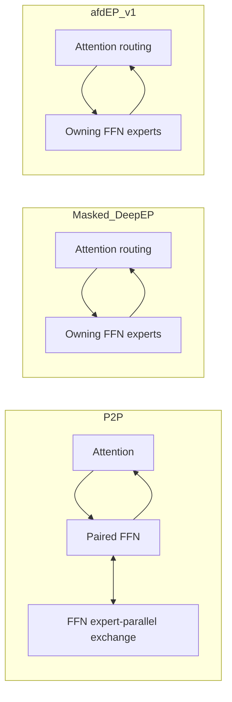

# AFD connector regression suite

Compare **P2P → Masked DeepEP → afdEP v1** on the same GPUs and requests.
The primary regression control is Masked DeepEP; the P2P comparison measures
complete serving paths, including its FFN expert-parallel exchange.



Masked DeepEP and v1 share scheduling, payload precision, expert compute and
transport. V1 enables explicit roles, removes unused Attention payload arenas
and empty-side epilogues, and bounds FFN receives by Attention source count.
Logical expert slots, collective participation and registered transport capacity
remain. P2P naturally uses BF16 payloads and FFN routing; the routed paths use
FP8 plus scales and Attention routing. Their difference is not transport alone.

## Initial baselines · 2026-10-19

Six balanced repeats per SKU, **16,704 measured requests each**. Percentages
below are paired geometric-mean throughput changes against Masked DeepEP.

| Workload | H100 | H200 |
| --- | ---: | ---: |
| Decode | -0.1% | +0.7% |
| Prefill | +5.5% | +2.8% |
| Mixed | +3.0% | +2.1% |
| Sustained | -0.7% (inconclusive) | +2.1% |

**Overall gate: inconclusive on both SKUs.** H100 sustained throughput, median
TPOT and TTFT intervals cross their budgets; H200 sustained TTFT intervals do
as well. No primary metric establishes a regression. This is not evidence that
all latency metrics are unchanged. Both routed paths also have worse sustained
P95 TTFT than P2P despite higher throughput.


| Evidence | H100 | H200 |
| --- | --- | --- |
| Measurements + request hashes | [Manifest](baselines/h100-nvlink-20261019/manifest.json) | [Manifest](baselines/h200-nvlink-20261019/manifest.json) |
| Ratios + 95% intervals + gates | [Comparison](baselines/h100-nvlink-20261019/comparison.json) | [Comparison](baselines/h200-nvlink-20261019/comparison.json) |
| Runtime + archive provenance | [Provenance](baselines/h100-nvlink-20261019/provenance.json) | [Provenance](baselines/h200-nvlink-20261019/provenance.json) |
| Single-request decode parity | [192/192 sequences](baselines/h100-nvlink-20261019/decode-parity.json) | [192/192 sequences](baselines/h200-nvlink-20261019/decode-parity.json) |

Parity covers seeded synthetic decode at concurrency 1, not general model
accuracy or concurrent-output equivalence. Full request events and role logs
are retained outside Git; the manifests contain their request-artifact hashes.
The initial manifest's `nccl_runtime` tuple is PyTorch's **build** version;
provenance separately verifies the loaded NCCL library as 2.30.7.

## Matrix

| Architecture | GPU baseline | Topology | Three-way suite |
| --- | --- | --- | --- |
| Hopper SM90 | H100 80 GB | 4 GPUs, one NVLink domain | Supported profile |
| Hopper SM90 | H200 | 4 GPUs, one NVLink domain | Supported profile |
| Hopper SM90 | H100 / H200 | Multiple domains over RoCE | Blocked: v1 role specialization rejects this topology |

H100 and H200 baselines remain separate despite sharing SM90. The runner checks
actual GPU names, count, architecture and NVLink connectivity. It refuses occupied
GPUs. Each role uses DP2/TP1; FFN EP2 owns 64 of Qwen's 128 experts per rank.

## Measure

| Workload | Input tokens | Output | Concurrency | Requests/repeat |
| --- | --- | --- | --- | --- |
| Decode | 32 | 64 | 1 | 32 |
| Prefill | 2,048 | 1 | 8 | 128 |
| Mixed | 32–2,048 | 64 | 32 | 256 |
| Sustained | 256 | 256 | 128 | 512 |

Metrics: output/input tokens per second, requests per second, request latency,
TTFT, TPOT and observed ITL. Report medians and P95. One-token prefill has no
TPOT. ITL uses adjacent single-token SSE events; coalesced events are reported,
not expanded into invented timings. GPU memory snapshots are total device usage
after a workload, not peak memory or registered communication capacity.

Startup, compilation, graph capture and request warmup are excluded. Every timed
graph replay, eager allocation and host-count wait is included. All variants use
`FULL_DECODE_ONLY`, identical capture sizes and scheduler limits; prefill is eager.
Prompt token IDs are synthetic and seeded; these are shape/load regression
profiles, not a production corpus or accuracy evaluation.
Prefix caching is disabled. Runs are finite and closed-loop, with ramp-up/drain
included; they do not measure offered-load SLOs or steady state. The common CUDA
DBO import guard is applied to all three paths.

## Run and gate

Install the checkout with its pinned afdEP extra and vLLM 0.30.0. Select matching
NCCL 2.30.7 headers/runtime **before** Python starts. Configure writable DeepEP,
DeepGEMM, vLLM and afdEP caches. `MODEL_PATH` must point to the pinned Qwen
snapshot; see the model revision emitted by `plan`.

```bash
python -m tools.benchmarks.afdep_suite plan --profile h100-nvlink
python -m tools.benchmarks.afdep_suite run --profile h100-nvlink \
  --model-path "$MODEL_PATH" --output results/h100-v1 --repeats 6
python -m tools.benchmarks.afdep_suite compare \
  results/h100-v1/manifest.json --output results/h100-v1/comparison.json
```

For charts, install Matplotlib and run
`python -m tools.benchmarks.afdep_plot results/h100-v1/manifest.json --output h100.svg`.

Use `h200-nvlink` for H200. Six repeats cover all connector-order permutations;
paired variants receive the same seeded prompts. Each server pair restarts between
variants. Keep raw request artifacts and role logs with the manifest and hashes.
Future changes rerun the same matrix with fresh P2P/Masked controls; no cross-SKU,
cross-fabric, model, graph-policy or runtime comparisons are accepted as a speedup.

The manifest records initial budgets: **3%** for throughput/median latency and
**5%** for tail latency. The gate resamples paired *repeats*, not individual
requests, with a 95% bootstrap interval. Fewer than six repeats are provisional;
intervals crossing the budget are inconclusive. Neither passes the gate.
A regression exits 2; inconclusive/provisional exits 3. Mark profiling runs with
`--instrumented`; known Nsight injection variables are detected automatically.
They cannot create an accepted baseline.

For transport diagnosis, exclude model GEMMs and compare the actual two backends:

```bash
EP_DISABLE_GIN=1 torchrun --standalone --nproc-per-node=4 \
  -m tools.benchmarks.afdep_exchange --variant afdep --payload fp8 \
  --mode graph --output exchange-afdep.json
```

Repeat with `--variant masked` and modes `eager-sync` / `eager-capacity`.
This includes a weighted identity reply; it is not pure network bandwidth.
The PyTorch identity reply touches receive capacity, including padding; use the
serving suite to judge model performance. The untimed expert-weighted check
preserves the two-stage BF16 reduction rounding. It reports every rank, critical
Attention round-trip time, registered transport bytes and PyTorch allocation
separately. P2P remains in the serving suite so its
second communication stage is preserved. Use separate Nsight Systems runs to
investigate regressions; never substitute trace timings for uninstrumented results.
